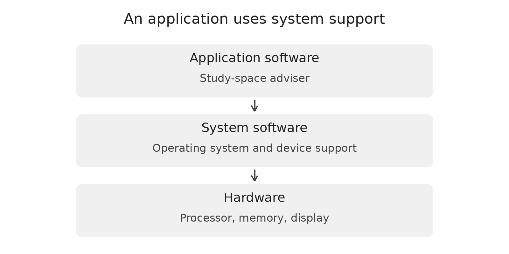
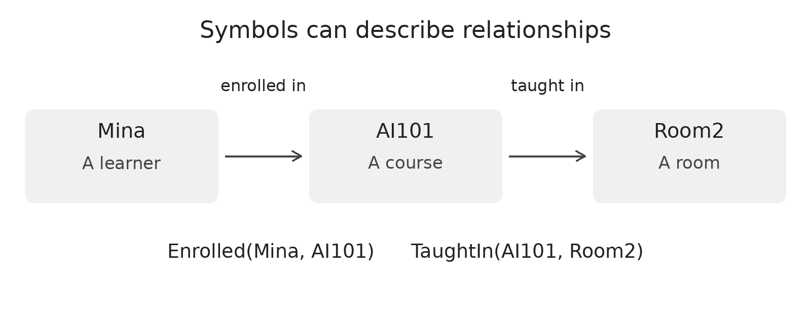
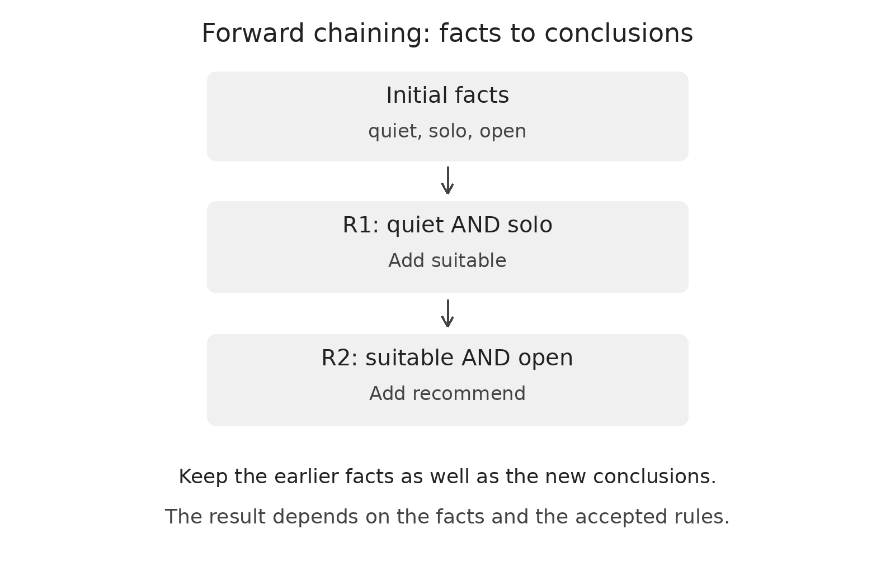
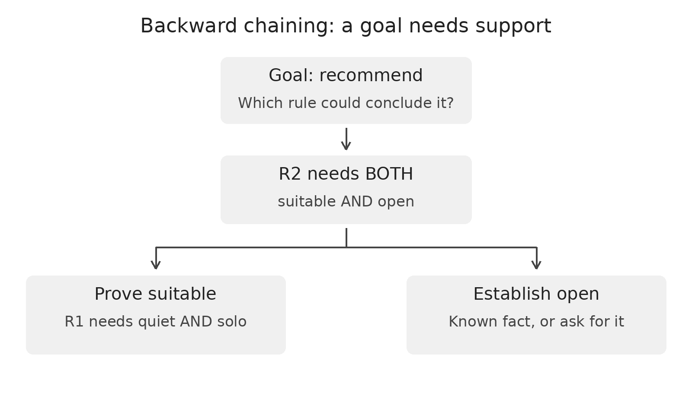
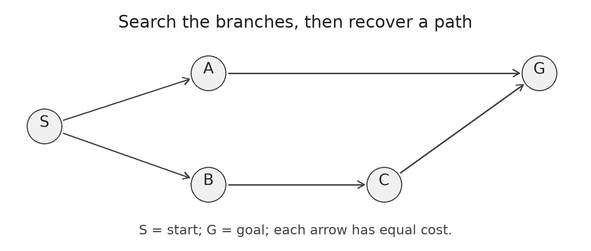
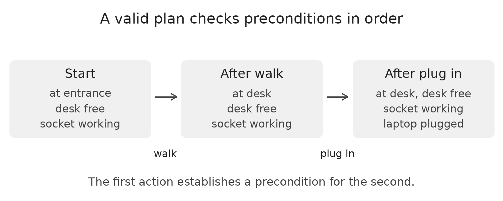
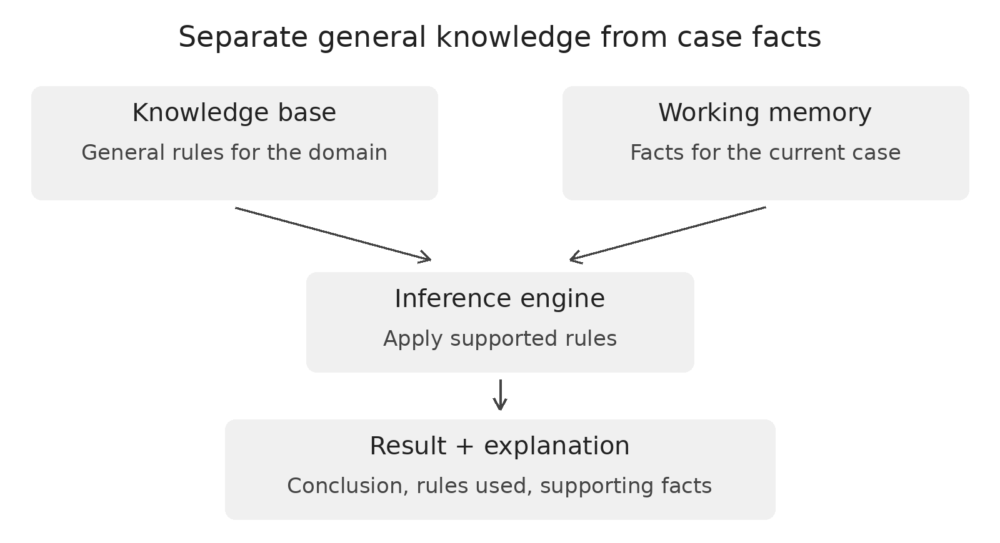

# Software + Symbolic AI

Version 1.0 - substantive Markdown learning module

This draft uses seven original diagrams in the accompanying `assets/` folder. Keep the folders together when uploading or downloading. Each chapter includes a paper activity, a quiz, and explained answers. On GitHub, click “Reveal quiz answers” after attempting the questions.

Audience: beginners who can follow ordinary IF/THEN instructions. No programming language is required. A Boolean value means true or false. Pseudocode is a readable plan for a program, rather than code in one particular language.

Topic in one sentence: software is the program and supporting instructions/data used to perform a task; symbolic AI represents knowledge explicitly and reasons over that representation.

Status: AI-assisted draft for the project team to review, personalise, and be ready to explain. All six chapters below are drafted. The required review by another team member remains pending. See the [module outline and development status](module-outline.md) and [review record](../docs/review-and-use.md). This revision was prepared on 29 October 2026; it does not establish what was submitted by the 24 October deadline.

## Learning outcomes

By the end, a learner should be able to:

1. Distinguish an application, system software, and hardware; specify an input, output, and test.
2. Define the symbols used in a small knowledge base and correctly evaluate AND, OR, NOT, and implication direction.
3. Trace forward and backward reasoning, identify missing support, and explain why a conclusion was reached.
4. Distinguish exploration order from a returned path and check the preconditions of a simple plan.
5. Separate general rules, case facts, and the inference engine in a small expert-system design.
6. Design normal, missing-information, inconsistent-input, and update tests; explain the limits of a reasoning trace.

## Contents

- [Chapter 1: Software foundations](#chapter-1-software-foundations)
- [Chapter 2: Symbols, facts, and logic](#chapter-2-symbols-facts-and-logic)
- [Chapter 3: Reasoning with rules](#chapter-3-reasoning-with-rules)
- [Chapter 4: Search and planning](#chapter-4-search-and-planning)
- [Chapter 5: Build a small expert system](#chapter-5-build-a-small-expert-system)
- [Chapter 6: Test, explain, and improve](#chapter-6-test-explain-and-improve)
- [Glossary](#glossary)
- [References](#references)

## How to use this module

Read the short explanation, inspect the visual, and predict the worked example before checking it. Complete the activity with paper or cards. Attempt the quiz before opening its answers. No programming is required; Chapter 5 also provides an optional runnable demonstration.

Notation: `R1`, `R2`, and `R3` identify the Chapter 3 reasoning rules. `R4` and `R5` identify the Chapter 5 rules. These are names, not priorities or steps. References use `Source 1`, `Source 2`, and so on. The relationship diagram uses `Room2` for a room, avoiding another use of `R2`.

Chapter 3 is the fully developed demonstration topic: its definitions, forward and backward worked examples, visual traces, transfer activity, expected outcomes, and misconception checks form one connected lesson. The other five chapters also contain substantive explanations, worked applications, activities, and answered quizzes.

All learner facts and room names below are fictional. A recommendation means “supported by this small model”, not a verified booking or a guarantee about an actual room.

## Chapter 1: Software foundations

Outcome: Distinguish an application, system software, and hardware; specify an input, output, and test.

Vocabulary before you start. A requirement states expected behaviour or a constraint. Validation checks whether inputs meet the stated rules for acceptable data.

Goal: connect the program you use to the task it performs and the hardware underneath.

### 1.1 Software and hardware

Software includes programs and supporting instructions and data. Hardware is the physical equipment that executes instructions. A study-space adviser is software; the phone running it is hardware.



Application software uses system-software support and physical hardware.

*Figure: Application software uses system-software support and physical hardware. Original diagram.*

### 1.2 Inputs become useful outputs

An application accepts input, processes it, and produces output. The operating system supports tasks such as managing files, memory, and devices. Keeping these roles separate makes a system easier to describe.

- Input: “I need quiet and a power socket.”
- Processing: Check the request against room facts and rules.
- Output: A suggested room and an explanation.


Try explaining it. Point to an app on your device. Name its input, one processing step, and its output. Then name one piece of hardware it uses.

Goal: distinguish an algorithm from a program, and describe success before building.

### 1.3 A plan and its implementation

An algorithm is a precise sequence of steps for completing a task; for the finite tasks here, the steps reach a stopping point. A program implements it in a programming language. “Collect needs, check facts, suggest a room” describes steps; code implements them.

- Define need: State the expected behaviour.
- Design: Plan inputs, rules, and outputs.
- Implement: Express the design in code.
- Test and improve: Compare expected and actual results, then revise.


Worked plan / A very small adviser

```text
Input: needs_quiet, room_A_quiet, room_A_open
If any required input is unknown:
    ask for the missing information
Otherwise if needs_quiet AND room_A_quiet AND room_A_open:
    display "Room A is a candidate"
Otherwise:
    display "This rule does not support room A"
```

### 1.4 Define and test the requirement

A requirement describes expected behaviour or a constraint. Example: “When room availability is unknown, ask for its status rather than assuming it is open.” A test gives specific inputs and the expected result.

- Need: Avoid missing information; Design choice: Validate required inputs; Concrete check: Unknown status → ask
- Need: Keep reasoning inspectable; Design choice: Record rules used; Concrete check: Show rule IDs in explanation
- Need: Allow corrections; Design choice: Edit facts, then recompute; Concrete check: Changed status → rerun


Software meets symbolic AI. Symbolic AI represents knowledge explicitly and reasons over it. An if-statement alone does not automatically make an application AI.

### Activity 1: Design an app on paper

Sketch a study-space adviser screen. Label two inputs and one output. Write a requirement for missing room-status information. Invent a test: give the input values and predict the exact message or action. Explain your design aloud.

Expected outcome: Example inputs: quiet needed and room status. Output: recommendation with reasons. If status is missing, ask “Is room A open?” before issuing an availability-dependent recommendation.

### Chapter 1 quiz

Attempt these before opening the answers below. Give reasons where requested.

1. Classify a study-space app, an operating system, and a physical screen as application software, system software, or hardware.
2. What is the difference between an algorithm and a program? Use the room-adviser task as your example.
3. Name one input, one processing step, and one output for the adviser.
4. Write an expected result for a test in which room availability is unknown. Why should you decide it before running the program?

Concept sources: [Source 1][Source1], [Source 2][Source2]. The learner/room examples and diagrams are original teaching models.


<details>
<summary>Reveal quiz answers</summary>

1. App: application software. Operating system: system software. Physical screen: hardware.
2. The algorithm is the plan, such as collect needs and apply room rules. A program implements that plan in a language.
3. Example: input “needs quiet”; process checks room facts; output suggests a suitable room with reasons.
4. Example: ask for availability. Expected behaviour comes from the requirement, not from copying the program’s output.

</details>

## Chapter 2: Symbols, facts, and logic

Outcome: Define the symbols used in a small knowledge base and correctly evaluate AND, OR, NOT, and implication direction.

Vocabulary before you start. A symbol is a defined representation. A Boolean condition evaluates to true or false when its inputs are specified. A predicate’s arguments are the values inside its parentheses, in a meaningful order.

Goal: turn everyday statements into symbols whose meanings are clear.

### 2.1 What is symbolic AI?

Symbolic AI represents relevant things, relationships, and rules explicitly, then manipulates that representation through reasoning or search. The symbols are a model of a situation. Define meanings such as “quiet” precisely.

- Represent: Define symbols and facts; Reason: Apply rules or search procedures; Explain: Show the conclusion and its support.


### 2.2 Facts can describe relationships

A fact is a statement accepted for the current case. A predicate names a property or relationship. Enrolled(Mina, AI101) says that Mina is enrolled in AI101; argument order is part of its meaning.



Mina is enrolled in AI101; AI101 is taught in Room2.

*Figure: Mina is enrolled in AI101; AI101 is taught in Room2. Original diagram.*

### 2.3 Use a small knowledge base

A knowledge base stores represented knowledge such as facts and rules. A rule with a variable can apply to several individuals: Enrolled(x, AI101) → CanReadNotes(x). Here, `x` stands for any learner. With Mina’s enrolment fact, substitute Mina for `x`.

Worked example:

1. Define `Enrolled(person, course)` and `CanReadNotes(person)`.
2. Record the case fact `Enrolled(Mina, AI101)`.
3. Read the rule as “For any learner x, if x is enrolled in AI101, x may read the notes.”
4. Replace `x` with `Mina`: `Enrolled(Mina, AI101) → CanReadNotes(Mina)`.
5. The condition is supported, so derive `CanReadNotes(Mina)`.

A fact describes this case; the rule describes a reusable relationship. Reversing the argument order changes the meaning. This is a small introduction to predicates, not a full first-order logic course.

Goal: read Boolean conditions and avoid reversing an implication.

### 2.4 AND, OR, and NOT

A proposition is a statement with a truth value. AND requires both statements. OR means at least one is true, including both. NOT reverses a truth value. Symbols: ∧, ∨, and ¬.

- A: T; B: T; A AND B: T; A OR B: T; NOT A: F
- A: T; B: F; A AND B: F; A OR B: T; NOT A: F
- A: F; B: T; A AND B: F; A OR B: T; NOT A: T
- A: F; B: F; A AND B: F; A OR B: F; NOT A: T


### 2.5 IF points in a direction

A → B reads “IF A THEN B”. If A is established and the rule is accepted, infer B. From “enrolled learners can read the notes”, knowing someone can read them does not alone prove enrolment; another rule might also grant access.

Useful example / All required conditions must hold

```text
IF needs_quiet AND room_A_quiet AND room_A_open
THEN room_A_is_a_candidate
```

Worked check: suppose `needs_quiet = true`, `room_A_quiet = true`, and `room_A_open = false`. The three-part AND is false, so the rule does not support a candidate. If all three are true, it supports a candidate. If availability has not been supplied, ask about it before making an availability-dependent recommendation.

Missing is not automatically false. This truth table evaluates fully specified T/F inputs. If room_A_open is absent from our knowledge, it is unknown to us. That is a knowledge gap, not a third value in this table. Do not infer “closed” without a stated policy or evidence.

### Activity 2: Translate and evaluate

Write three clear facts about a fictional learner and room. Create a rule joining two facts with AND. Evaluate it when A is true and B is false, then when both are true. Explain what you can say if B has not been supplied at all.

Expected outcome: Example: quiet_needed, room_A_quiet, room_A_open. An AND condition is false for T/F and true for T/T. If an input is missing, obtain it rather than silently replacing it with false.

### Chapter 2 quiz

Attempt these before opening the answers below. Give reasons where requested.

1. Translate Enrolled(Mina, AI101) into an ordinary sentence. What does the argument order tell you?
2. For A = true and B = false, give A AND B, A OR B, and NOT A.
3. Given only A → B and B, can you conclude A? Explain briefly.
4. If room_A_open is missing, does our guide assume the room is closed? What should the application do if availability is required?

Concept sources: [Source 3][Source3], [Source 7][Source7], [Source 8][Source8]. The learner/room examples and diagrams are original teaching models.


<details>
<summary>Reveal quiz answers</summary>

1. Mina is enrolled in AI101. The first argument is the learner and the second is the course under this definition.
2. False, true, and false. AND needs both; inclusive OR needs at least one; NOT reverses A.
3. No. The rule provides a direction from A to B; B can hold for another reason.
4. No. The status is unknown in this case. Ask for or obtain the required availability fact.

</details>

## Chapter 3: Reasoning with rules

Outcome: Trace forward and backward reasoning, identify missing support, and explain why a conclusion was reached.

### 3.1 The reasoning task and vocabulary

We want a study-space adviser to decide whether the rules support a recommendation. A fact is a statement accepted for this case. A rule relates conditions to a conclusion. Inference means deriving a conclusion by an accepted reasoning step. A premise is a supporting condition; a conclusion is what follows when the rule is applied.

Here is the complete vocabulary for this example. Nothing else is needed to complete the activity.

- `quiet`: The learner needs a quiet place.
- `solo`: The learner will study alone.
- `open`: The modelled quiet room is known to be open.
- `suitable`: The needs fit the type of quiet room under R1.
- `recommend`: The recommendation is supported under R2.


The distinction matters: `quiet` describes a learner's need; it does not itself establish that any real room is quiet. These are deliberately simplified room-selection rules.

```text
R1: IF quiet AND solo THEN suitable
R2: IF suitable AND open THEN recommend
```

The general reasoning pattern is: if a rule's conditions are established, its conclusion may be added. For `A → B`, knowing A supports B. Knowing B alone does not establish A. [Source 3][Source3] [Source 4][Source4]

### 3.2 Worked example: forward chaining

Forward chaining begins with available facts and derives supported consequences. Start with exactly these inputs:

```text
quiet, solo, open
```

1. Check R1. Both `quiet` and `solo` are known, so add `suitable`.
2. Keep the original facts. The known facts are now `quiet`, `solo`, `open`, and `suitable`.
3. Check R2. Both `suitable` and `open` are now known, so add `recommend`.
4. Check whether anything else can be added. No new conclusion remains in this two-rule example, so stop.



Forward reasoning from quiet, solo, and open through R1 to suitable and R2 to recommend.

- Step: Start; Rule checked: None; Conditions established? Initial inputs supplied; New fact: None; Why? No rule has fired yet.
- Step: 1; Rule checked: R1; Conditions established? `quiet`: yes; `solo`: yes; New fact: `suitable`; Why? Both required inputs hold.
- Step: 2; Rule checked: R2; Conditions established? `suitable`: yes; `open`: yes; New fact: `recommend`; Why? R1 supplied the intermediate fact.
- Step: 3; Rule checked: R1 and R2; Conditions established? No new conclusion; New fact: None; Why? Re-adding known facts is unnecessary.


The proof trace is the recorded chain of supporting facts and rules: `quiet` and `solo` support `suitable` via R1; `suitable` and `open` support `recommend` via R2. This is an explanation of the model's derivation. It is not evidence that every input fact is true in the real world.

### 3.3 Change one input: what if open is missing?

Restart from the current inputs `quiet` and `solo`; do not keep a recommendation from an earlier case.

- R1 needs quiet and solo: Both are known: add `suitable`.
- R2 needs suitable and open: `open` is missing: R2 cannot add `recommend`.
- Can we say the room is closed? No. The missing statement does not establish its opposite.
- What should the interface do? Ask “Is the quiet room open?” or report missing support.


In this lesson, unknown means that the knowledge base does not establish the needed statement or its opposite. It describes our information, not a third truth value in the earlier Boolean truth table. We do not adopt an unstated “anything unproved is false” policy.

### 3.4 Worked example: backward chaining

Backward chaining begins with a goal and looks for support. The goal is `recommend`.

1. Find a rule that concludes `recommend`: R2.
2. R2 requires both `suitable` and `open`; these become subgoals, meaning smaller goals needed to support the main goal.
3. To support `suitable`, find R1. It requires `quiet` and `solo`.
4. Check whether `quiet` and `solo` are input facts. If they are, R1 supports `suitable`.
5. Check `open`. If it is supplied, R2 supports the main goal. If it is missing, obtain that information or report the proof gap.



Backward proof tree: recommend requires suitable and open; suitable requires quiet and solo.

Forward and backward chaining describe different directions of reasoning, not different meanings of these two rules. In larger systems, a procedure must also track repeated facts or repeated goals to avoid cycling. A loop such as “X implies Y; Y implies X” supplies no starting evidence for either statement. Backward reasoning is useful when one particular question is the focus. [Source 5][Source5]

### 3.5 Common mistakes and how to detect them

- Apply an AND rule when only one condition is known: `quiet` alone does not satisfy R1. `solo` is also required.
- Treat the conclusion as proof of its premise: `A → B` and B do not establish A; another rule could also support B.
- Treat a missing fact as its opposite: Missing `open` is not a fact `closed`.
- Keep conclusions after changing the original inputs: For this simple design, clear derived facts and recompute from current inputs.
- Trust a result because its explanation is neat: A valid derivation can still start from a false room-status fact.


### 3.6 Learner activity: become the inference engine

Materials: five labelled cards (`quiet`, `solo`, `open`, `suitable`, `recommend`), two rule cards, and paper.

1. Write R1 and R2 exactly as above. Place only `quiet`, `solo`, and `open` in the initial-facts area.
2. Apply supported rules. For each new card, write the rule ID and the facts that allowed it.
3. Start a fresh case with `quiet` and `solo`, leaving out `open`. Record what follows and the next question the software should ask.
4. Start another fresh case with `solo` and `open`, leaving out `quiet`. Identify the earliest blocked rule.
5. Explain the goal `recommend` backwards, identifying every required input.
6. Transfer: add R3: `group AND group_room_open → recommend_group_room`. With only `group`, explain what is missing.

Expected outcomes and reasoning:

- Case 1: R1 adds `suitable`, then R2 adds `recommend`; every step has both required conditions.
- Case 2: R1 adds `suitable`; R2 lacks `open`. Ask about room status. Do not label the room closed.
- Case 3: R1 lacks `quiet`, so it cannot add `suitable`; R2 consequently lacks that intermediate support. `solo` and `open` alone are insufficient under these rules.
- Backward explanation: `recommend` needs `suitable` and `open`; `suitable` needs `quiet` and `solo`.
- Transfer: `group_room_open` is required for R3. `group` alone does not support `recommend_group_room`.

Understanding check: change the words while keeping the logical structure. Explain why “has a ticket AND gate is open → may enter” still requires both conditions.

### Chapter 3 quiz

Attempt these before opening the answers below. Give reasons where requested.

1. With facts quiet, solo, open and the two displayed rules, which new facts follow, and in what dependency order?
2. How does backward chaining begin differently from forward chaining?
3. If open is missing, which rule is blocked? Does this prove that the room is closed?
4. What should a useful explanation record, and why does an explanation not by itself guarantee a true real-world conclusion?

Concept sources: [Source 4][Source4], [Source 5][Source5]. The learner/room examples and diagrams are original teaching models.


<details>
<summary>Reveal quiz answers</summary>

1. R1 derives suitable; then R2 derives recommend. suitable is the intermediate supporting fact.
2. Backward chaining begins with a goal and seeks support. Forward chaining begins with known facts and derives consequences.
3. R2 lacks open, so recommend is not supported by it. Missing open does not establish closed.
4. Record rules used and their supporting facts. A valid trace can still depend on false or outdated premises.

</details>

## Chapter 4: Search and planning

Outcome: Distinguish exploration order from a returned path and check the preconditions of a simple plan.

Vocabulary before you start. A state describes the relevant situation. A queue removes the earliest-added item first; a stack removes the latest-added item first. Recursion is a procedure calling itself on another instance. A precondition must hold before an action; an effect describes what the action changes.

Goal: separate the order of exploration from the final solution path.

### 4.1 Represent a search problem

A state describes the relevant situation. Actions lead to successor states. A goal test says whether the target has been reached. The frontier is the collection of states or partial paths still waiting to be explored.



Directed graph: S to A and B; A to G; B to C; C to G.

*Figure: Directed graph: S to A and B; A to G; B to C; C to G. Original diagram.*

### 4.2 Breadth-first search uses a queue

BFS explores shallower possibilities first. Here, expand A before B when both are available, mark states when queued, and test the goal when removing a state. The returned path is S → A → G. Marking discovered states prevents repeated exploration when another route reaches the same state; on a graph with cycles, this also avoids repeatedly following the cycle.

- Remove: S; Queue afterwards: [A, B]; Meaning: Discover the two next states.
- Remove: A; Queue afterwards: [B, G]; Meaning: G is reached through A.
- Remove: B; Queue afterwards: [G, C]; Meaning: C is reached through B.
- Remove: G; Queue afterwards: Stop; Meaning: Return path S → A → G.


Exploration order is not the plan. S, A, B, G is the removal order, but S → A → B → G is not a path in this diagram. Reconstruct the solution through the recorded parent links.

Goal: connect a symbolic action description to a valid sequence of steps.

### 4.3 Compare BFS with depth-first search

DFS follows a branch deeply before backing up; a stack or recursion can manage its frontier. If it explores B first here, it may return S → B → C → G. BFS returns a fewest-action path when actions have equal cost; DFS does not generally guarantee that.



Walk changes at_entrance to at_desk; plugging in then establishes laptop_plugged when socket_working holds.

*Figure: Walk changes at_entrance to at_desk; plugging in then establishes laptop_plugged when socket_working holds. Original diagram.*

- Action: Walk to desk; Preconditions: at entrance AND desk free; Effects in this toy model: Add at_desk; remove at_entrance.
- Action: Plug in laptop; Preconditions: at desk AND socket working; Effects in this toy model: Add laptop_plugged.


### 4.4 Check the whole sequence

A precondition must hold before an action; an effect is the change the action models. A plan is a sequence of actions intended to reach a goal. “Plug in, then walk” fails because the first action needs at_desk. “Walk, then plug in” reaches at_desk AND laptop_plugged when the listed starting facts hold.

Reasoning and action are different. A rule can derive knowledge without moving anything. A planning action changes a modelled world state. The plan is only as useful as its action model and current facts; a blocked desk can invalidate an earlier plan.

### Activity 4: Search and act on paper

Redraw the state graph in this chapter. Run BFS using A before B, and record the queue. Then trace DFS choosing B first. For the desk plan, cross out each old fact and add each new fact after an action. Try removing socket_working.

Expected outcome: BFS removes S,A,B,G; queues become [A,B], [B,G], [G,C], then stop. DFS via B can find S-B-C-G. Walk then plug succeeds only if the required starting facts hold.

### Chapter 4 quiz

Attempt these before opening the answers below. Give reasons where requested.

1. What path does the displayed BFS return from S to G, and how many actions does that path contain?
2. Why is the removal order S, A, B, G different from the returned path?
3. If DFS explores B before A, what first solution path may it find? Is it a fewest-action path here?
4. Why is “plug in, then walk” invalid from the given starting state? What fact blocks plugging in if socket_working is unknown?

Concept sources: [Source 6][Source6], [Source 9][Source9]. The learner/room examples and diagrams are original teaching models.


<details>
<summary>Reveal quiz answers</summary>

1. S → A → G, containing two actions (two arrows).
2. Search explores alternative branches. The final path follows parent links; there is no A → B arrow.
3. S → B → C → G, with three actions. It is longer than the two-action path in this example.
4. Plugging in requires at_desk before the walk. If socket_working is unknown, that required precondition is not established.

</details>

## Chapter 5: Build a small expert system

Outcome: Separate general rules, case facts, and the inference engine in a small expert-system design.

Vocabulary before you start. The user interface is the part a person interacts with. The knowledge base stores general represented knowledge; working memory stores current-case facts; the inference engine is the procedure applying the rules.

Goal: identify the pieces of a rule-based expert system.

### 5.1 Put domain knowledge in a usable form

An expert system applies represented domain knowledge to a bounded task. A classic rule-based design separates general rules, current-case facts, and a reasoning procedure. Our study-space adviser is a simplified learning example, not a substitute for a complete room-booking service.



A knowledge base and current facts feed an inference engine, which returns a conclusion and explanation.

*Figure: A knowledge base and current facts feed an inference engine, which returns a conclusion and explanation. Original diagram.*

### 5.2 Make the interface gather the right facts

A user interface collects the learner’s needs and obtains room information. Working memory holds those current-case facts. The inference engine matches them against rules in the knowledge base and records conclusions.

### 5.3 Keep updating the knowledge

Rules might come from policy documents or people who understand the domain. Check their meaning with examples. Room facts can become stale; a clear explanation should reveal which facts were used and when they were obtained.

Useful separation. Changing a room rule need not mean redesigning the user interface. Separating knowledge and reasoning makes inspection easier, but changes still need tests.

Goal: connect collected inputs, a rule chain, and an explainable result.

Case facts: `quiet`, `power`, `open_A`, `quiet_A`, `power_A`.

The two rules / Positive conditions only

```text
R4: quiet AND power -> needs_quiet_power
R5: needs_quiet_power AND open_A AND quiet_A
    AND power_A -> recommend_A
```

- What does R4 add? needs_quiet_power
- What does R5 add? recommend_A
- Why recommend A? A meets the known requirements.


### 5.4 Repeat until no new fact is added

A simple engine scans the rules, adds supported conclusions, and repeats if anything new appeared. Store facts as a set (a collection without duplicates) and record each derivation. For these positive rules over finitely many possible facts, ignoring duplicate conclusions allows the process to stop.

### 5.5 Handle gaps instead of guessing

If open_A is not known, R4 can still fire but R5 cannot. Ask for A’s status. If two rooms qualify, a separate policy can rank candidates or show both; the rules have not automatically chosen a unique winner.

Naming matters. quiet and power are learner needs; quiet_A and power_A are room properties. Never substitute one for the other.

### Optional demonstration: run the same rules

If you have Python 3 installed, run this command from the repository folder:

```bash
python3 examples/study_space_adviser.py
```

The [example source](../examples/study_space_adviser.py) runs four labelled cases: all facts, missing availability, known closed, and contradictory status. It prints which rules fired and why. No packages or network connection are needed. A new call starts with fresh case facts, so old conclusions do not leak into another case.

Expected full-case trace: `R4` derives `needs_quiet_power`; `R5` derives `recommend_A`. When `open_A` is unknown, the program asks for status. When `closed_A` is known, it reports the room as closed. The invalid combination `open_A` plus `closed_A` is rejected before reasoning. These are policies of our teaching example, not automatic properties of every symbolic AI system.

### Activity 5: Build the adviser with cards

Make five fact cards: quiet, power, open_A, quiet_A, power_A. Write R4 and R5 from this chapter on separate cards. Apply them and draw the explanation chain. Remove open_A and rerun from the original remaining inputs. Write the next question the app should ask.

Expected outcome: All five inputs support R4 then R5. Without open_A, only needs_quiet_power is added. Ask “Is room A open?” Recompute from current inputs rather than retaining an outdated recommendation.

### Chapter 5 quiz

Attempt these before opening the answers below. Give reasons where requested.

1. What is the difference between the knowledge base, working memory, and inference engine?
2. With the five shown input facts, which intermediate fact and final recommendation are derived?
3. If open_A is absent, what can R4 still derive, and why can R5 not produce recommend_A?
4. Why should an engine avoid repeatedly adding an already-known fact? What extra policy is needed if several rooms qualify?

Concept sources: [Source 7][Source7], [Source 4][Source4], [Source 10][Source10]. The learner/room examples and diagrams are original teaching models.


<details>
<summary>Reveal quiz answers</summary>

1. The knowledge base holds general knowledge such as rules; working memory holds case facts; the engine applies the rules.
2. R4 derives needs_quiet_power. With all A properties established, R5 derives recommend_A.
3. R4 derives needs_quiet_power. R5 lacks its required open_A condition, so its conclusion is unsupported.
4. Duplicate handling avoids useless repeated work. Ranking or presenting multiple candidates needs an explicit selection policy.

</details>

## Chapter 6: Test, explain, and improve

Outcome: Design normal, missing-information, inconsistent-input, and update tests; explain the limits of a reasoning trace.

Vocabulary before you start. A test case specifies starting inputs and an expected result. An explanation trace records the supporting facts and reasoning steps; coverage describes which situations the model or tests address.

Goal: compare actual results with expectations and look for missing cases.

### 6.1 Start with a concrete expected result

A test specifies the initial facts, rules or policy, and expected output. Decide the expectation independently of the program’s output. Test rule logic as well as input validation and the displayed explanation.

- All five case-study facts: Derive needs_quiet_power and recommend_A.
- No open_A fact: Do not derive recommend_A through R5; ask for status.
- Both open_A and closed_A: Flag the inconsistent input under our validation policy.
- Replace open_A with closed_A: Recompute; do not retain the old R5 recommendation.


### 6.2 Keep rules and inputs consistent

Contradictory room-status inputs should be noticed rather than silently resolved. This adviser uses a validation rule that rejects “open” and “closed” together. If multiple valid recommendations remain, decide how to show or rank them.

Save the case that exposed the bug. A regression test reruns a useful case after later changes. Example: when availability changes, confirm that a recommendation derived from old facts disappears after recomputation.

Goal: explain where symbolic methods help, and what their explanations cannot guarantee.

- Explicit rules are inspectable: Writing and maintaining enough rules takes effort.
- Reasoning can show a clear trace: A clear trace can still use mistaken premises.
- Domain constraints are expressible: Unrepresented situations may fall outside coverage.
- Rules can be edited directly: Changes can interact with other rules unexpectedly.


### 6.3 Symbols need a connection to the world

A symbol such as quiet_A means little without a way to establish what counts as quiet and whether room A meets it now. Ambiguous meanings and stale facts can defeat a technically correct rule chain. The application should show missing support and accept corrections.

- Specify: Write the expected result.; Run: Obtain the actual result.; Compare: Explain a match or investigate a difference.


### 6.4 Symbolic and learned methods can cooperate

A learned component is a model whose behaviour is fitted from data. As an original design extension, a symbolic component could check policy rules while a learned component estimates a property from data. These approaches are not mutually exclusive. If a sensor model estimates room noise, treat the estimate and its uncertainty appropriately rather than pretending it is an infallible logical fact.

Final self-check. Can you state the software’s purpose, define its symbols, trace a rule, name a missing fact, and design a test that could reveal an error? If so, you can explain the core of this module.

### Activity 6: Audit and improve the adviser

Create four test cases: all facts present, one required fact missing, contradictory room status, and a changed status after an earlier recommendation. Write the expected result before tracing. Add one improvement, such as showing fact timestamps or asking a clearer question.

Expected outcome: Expect a recommendation only with the required support. Ask on missing status; flag contradictory status; recompute after updates. An improvement is to show when each room fact was last checked.

### Chapter 6 quiz

Attempt these before opening the answers below. Give reasons where requested.

1. For the case-study rules, what should happen when open_A is missing? How is this different from known closed_A?
2. Under the stated validation policy, what should happen if both open_A and closed_A are supplied?
3. Why does an explanation trace not guarantee that the suggested room is actually suitable now?
4. Name one strength and one limitation of symbolic AI. Give one sensible role for a learned component alongside rules.

Concept sources: [Source 1][Source1], [Source 7][Source7]. The learner/room examples and diagrams are original teaching models.


<details>
<summary>Reveal quiz answers</summary>

1. Missing status calls for more information. Known closed_A supplies negative availability information; R5 still lacks open_A.
2. Flag or reject the inconsistent case before presenting a status-dependent recommendation.
3. The premises may be wrong, stale, or poorly defined even if the derivation follows its rules correctly.
4. Example: inspectable rules, but costly maintenance. A learned model could estimate noise while rules check stated constraints.

</details>

## Glossary

- Software: Programs and supporting instructions/data that perform tasks.
- Algorithm: Clear steps for solving a specified task.
- Symbol: A defined representation of an entity, property, or idea.
- Fact: A statement accepted for the current reasoning case.
- Predicate: A named property or relationship with arguments.
- Knowledge base: Stored represented knowledge, including rules or facts.
- Inference: Deriving a conclusion using supported reasoning steps.
- Rule: An explicit relationship between conditions and a conclusion.
- Forward chaining: Starting with facts and deriving their consequences.
- Backward chaining: Starting with a goal and seeking its required support.
- Working memory: The facts held for the current case.
- Inference engine: The procedure that applies knowledge to case facts.
- State: A description of the relevant situation in a search model.
- Goal test: A check that a target condition has been reached.
- Precondition: A condition that must hold before an action is applied.
- Effect: A modelled change caused by an action.
- Expert system: A system applying domain knowledge to a bounded task.
- Regression test: A retained test used to detect a returning defect.
- Premise: A condition used to support an inference.
- Subgoal: A smaller goal that supports another goal.
- Frontier: Search states or partial paths still waiting to be explored.
- Boolean: A true-or-false value.
- Pseudocode: A readable algorithm description independent of one programming language.


## References

These sources support the underlying concepts. The worked room examples, activities, lists of expected outcomes, and diagrams were written for this module; no source illustrations or textbook passages were copied. Sources reopened and checked for the relevant concepts on 29 October 2026. Older course editions are identified deliberately. References explain the concepts; the room rules and validation policies are original, simplified teaching choices.

- Source 1. Quiroz-Vázquez, Camilo. IBM Think, *What is software development?* Software types, user needs, development stages, and testing. https://www.ibm.com/think/topics/software-development
- Source 2. Malan, David J. Harvard CS50x 2025, *Lecture 0*, sections on inputs/outputs, algorithms, pseudocode, and Boolean expressions. https://cs50.harvard.edu/x/2025/notes/0/
- Source 3. UC Berkeley CS 188, *10.3 Propositional Logic*. Propositions, truth assignments, and logical connectives. https://inst.eecs.berkeley.edu/~cs188/textbook/logic/propositional.html
- Source 4. UC Berkeley CS 188, *10.6 Forward Chaining*. Applying supported implication rules to add conclusions. https://inst.eecs.berkeley.edu/~cs188/textbook/logic/forward.html
- Source 5. Harvey, Brian. UC Berkeley, *Reasoning with Computers*, section “Forward and Backward Chaining”. Directions of reasoning and the need to state an inference system's limits. https://people.eecs.berkeley.edu/~bh/logic.html
- Source 6. UC Berkeley CS 188, *1.3 Uninformed Search*. Frontiers, breadth-first and depth-first exploration, and equal-cost conditions for BFS optimality. https://inst.eecs.berkeley.edu/~cs188/textbook/search/uninformed.html
- Source 7. UC Berkeley CS 188, *10.1 A Knowledge Based Agent*. Knowledge bases and drawing conclusions from represented knowledge. https://inst.eecs.berkeley.edu/~cs188/textbook/logic/knowledge.html

- Source 8. UC Berkeley CS 188, *10.7 First Order Logic*. Objects, predicates, arguments, and variables. https://inst.eecs.berkeley.edu/~cs188/textbook/logic/first-order-logic.html
- Source 9. Poole, David, and Alan Mackworth. *Artificial Intelligence: Foundations of Computational Agents*, first edition, section 8.2, “Forward Planning”. States, action preconditions/effects, and plans. https://artint.info/html1e/ArtInt_206.html
- Source 10. Giarratano, Joseph C. *CLIPS 6.4 User’s Guide*, “Just the Facts” and “Following the Rules”. Rule-based expert systems, facts, and inference engines. https://www.clipsrules.net/documentation/v642/ug642.pdf

[Source1]: https://www.ibm.com/think/topics/software-development
[Source2]: https://cs50.harvard.edu/x/2025/notes/0/
[Source3]: https://inst.eecs.berkeley.edu/~cs188/textbook/logic/propositional.html
[Source4]: https://inst.eecs.berkeley.edu/~cs188/textbook/logic/forward.html
[Source5]: https://people.eecs.berkeley.edu/~bh/logic.html
[Source6]: https://inst.eecs.berkeley.edu/~cs188/textbook/search/uninformed.html
[Source7]: https://inst.eecs.berkeley.edu/~cs188/textbook/logic/knowledge.html

[Source8]: https://inst.eecs.berkeley.edu/~cs188/textbook/logic/first-order-logic.html
[Source9]: https://artint.info/html1e/ArtInt_206.html
[Source10]: https://www.clipsrules.net/documentation/v642/ug642.pdf
